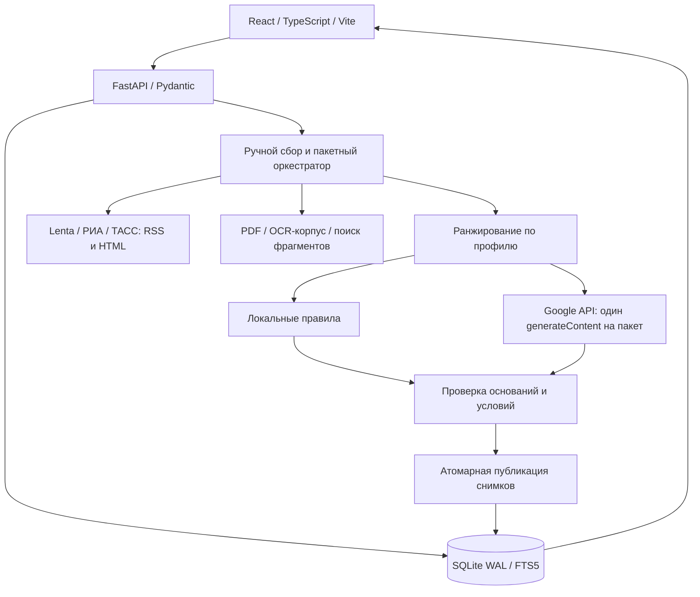

# Архитектура актуальной версии 1.4.1

Frontend: React Router, TanStack Query, роли CEO/CFO/казначейство. В Docker
интерфейс собран Vite и обслуживается тем же Uvicorn, что и API.

Backend: типизированный /api/v1, cookie-сессия для localhost, CSRF, разграничение
компаний и системных ролей. HTTP-загрузчик проверяет публичный адрес и TLS;
обход ограничений издателей не выполняется. ТАСС RSS-анонс отличается от полного HTML.

Пайплайн: ручной запуск → контекст трёх компаний → сбор и дедупликация новостей →
поиск банковских фрагментов → ранжирование → до девяти пар → максимум один запрос
к Google → проверка точных цитат и ID → атомарная запись новых снимков. Только
валидированные ответы кэшируются. При отказе отдельной пары используются локальные
правила с соответствующей меткой, без repair-запроса и платного fallback.
Автоматический сбор и автоматическая генерация отключены. Опрос статуса в браузере
не запускает новые генерации.

Google: native REST generateContent через httpx, точный ID gemma-4-26b-a4b-it,
таймаут генерации 240 секунд. Секрет остаётся на backend. Перед внешней передачей
профиля требуется согласие в настройках. OpenRouter сохранён как регрессионный
адаптер, основным провайдером текущей конфигурации не является.

SQLite хранит компании, источники/фрагменты/FTS5, события, версии разборов, запуски,
пакеты, кэш, квоты, настройки, сохранения, обратную связь и сессии. История immutable;
незавершённый пакет после restart прерывается, а не повторяет генерацию. Постоянный
том Compose сохраняет историю. Миграции и фактическая схема — backend/migrations
в исходниках; контракты — data-contracts.md, OpenAPI — ../openapi.json.

AI-помощник — интерфейсное окно «Скоро». Банковские операции и production SSO
не подключены. Локальный прототип не является распределённой production-системой.
